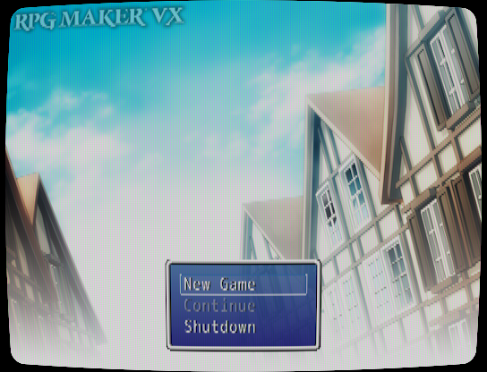
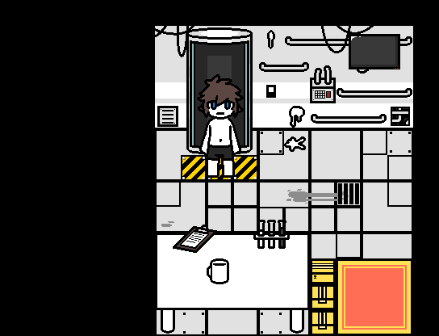
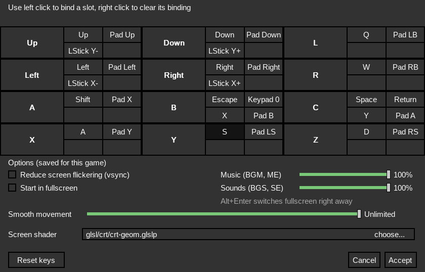

# MKXP-Z Patcher

Run RPG Maker XP, VX and VX Ace games natively on **Linux** and **Windows** with
the open-source [mkxp-z](https://github.com/mkxp-z/mkxp-z) engine, without
touching the game's own files.

The patcher analyzes a game folder, builds the mkxp-z engine for the chosen
platforms (once; later games reuse it) and adds it to the game next to a
launcher. Removing the patch removes everything it added again (only your
mkxp-z settings, key bindings and shaders stay).

<p align="center">
  
</p>

## Features

- **Platforms:** Linux (x86 64/32-bit, ARM 64/32-bit) and Windows
  (32-bit, 64-bit, ARM64). Linux builds every engine (Windows ones are
  cross-compiled); Windows builds the x86 Windows engines in a portable MSYS2
  it sets up by itself. In the window you choose one system (Linux, Linux
  legacy, Windows, Windows legacy, Android) and one CPU type (32-bit, 64-bit,
  ARM 32-bit, ARM 64-bit). Windows has no ARM 32-bit engine, Windows legacy is
  32-bit only and Linux legacy x86 only; CPU types a system has no engine for
  are greyed out. The command line can add
  several engines at once (`--platform linux,windows`).
- **Older systems:** the patcher and the engines run on Windows 7 or newer
  (32-bit Windows: `mkxpz-patcher-windows-i686.exe`) and on Linux systems from
  2020 on (glibc 2.31: Ubuntu 20.04, Debian 11, SteamOS 3 and newer; see
  Building for how the Linux x86 engines get there). On Windows 7/8 and 32-bit
  Windows the patcher patches with engines built elsewhere (building them
  needs 64-bit Windows 10 or newer, or Linux). Graphics: OpenGL 2.0, or
  Direct3D 11 on Windows.
- **Windows XP (experimental):** "Windows legacy (XP)" (`--platform
  windows-xp`) patches with only the legacy 32-bit engine, `mkxp-z.xp.exe`,
  which the game's Game.exe starts on XP and on newer Windows too. On the
  command line it can also go next to the normal one (`--platform
  windows,windows-xp`): Game.exe then starts the normal one on newer Windows. It's
  built for XP's system functions and without ANGLE, HTTPS and Ruby's socket
  module, draws with OpenGL (2.0 needed) and needs no SSE2 (Pentium III,
  Athlon XP). After building, the patcher checks that it uses nothing newer
  than XP. The patcher itself needs Windows 7, so patch the game on another
  computer and copy it over.
- **Android (experimental):** "Android" (`--platform android-arm64 --apk`)
  makes an APK of the game next to its folder: ARM 64-bit for phones and
  tablets, 64-bit (`android-x86_64`) for the Android emulator and Waydroid
  (`--platform android` puts both into one APK). Android 8.0 or newer; the
  first start copies the game into the app's storage, where it keeps its
  saves. Making APKs needs Linux (x86-64): Google's Android tools (NDK, SDK
  build tools, a JDK; about 1.1 GB, 3.9 GB unpacked) are downloaded into
  `android-sdk/` next to the engines folder, and APKs are signed with a key
  made there once (`apk-signing.keystore`; keep it, later APKs of a game must
  be signed with the same key to install as updates). On touchscreens the
  app shows touch controls (a D-pad and OK / Back / Dash buttons; they hide
  while a keyboard or controller is used). The menu button at the top right,
  or the Back key, opens a menu with the settings (mkxp-z's F1 menu: volume,
  smooth movement, widescreen, screen shader, key bindings for controllers),
  resetting the game (F12) and quitting.
- **Game analysis:** RGSS version, encrypted archives, fonts the game asks for
  (with a CJK fallback font when its text needs one), MIDI music (SoundFont),
  RTP, Win32API use, Steam versions.
- **Compatibility fixes** for scripts that rely on RPG Maker internals:
  Fullscreen++ (F5/F6 keep working), "fast Bitmap Marshal" save screenshots
  (save files stay compatible with the original Game.exe), RGSS memory reads.
- **Settings menu (F1)** inside the game: key bindings, vsync, fullscreen at
  start, widescreen, music and sound volume, frame interpolation and a screen
  shader.
  Saved per game in `mkxp-z/mkxp.json` and `mkxp-z/keybindings.mkxp*`.
- **Smooth movement:** frame interpolation for displays faster than the game
  (e.g. 60 FPS games on 120/144/165 Hz screens), adjustable in 1 FPS steps up
  to the display's refresh rate, or unlimited; the multiples of the game's rate
  (2x, 3x ...) are marked.
- **Widescreen (VX / VX Ace, off by default):** F1 > "Widescreen" has three
  choices:
  - *Off*
  - *16:9, scene colors at the sides*: a 16:9 window with the game in its own
    size in the middle; the sides show the scene's colors, blurred and
    darkened. The game itself is unchanged. (With a screen shader the sides
    stay black.)
  - *16:9 wider map view* (experimental): maps are shown in 16:9 (736x416)
    with more of the map around the player. Title, menus and battles keep the
    game's own size, in the middle with colored sides; maps narrower than the
    screen and the game's pictures stay centered, with black bars beside
    full-screen pictures. Custom HUDs placed for the original screen stay
    where the game put them (left part of the view).
- **Screen shaders:** libretro GLSL shaders and presets
  ([libretro/glsl-shaders](https://github.com/libretro/glsl-shaders)), e.g.
  CRT effects, chosen in the F1 menu.
- **AppImage:** pack a game with its Linux engine into one file
  (`--appimage` or "Create AppImage"); saves and settings go to the user's
  folders.
- **Steam versions:** the 32-bit Windows engine uses the game's own
  `steam_api.dll`, also under Proton; an optional log shows every Steam call
  (e.g. achievements).
- **Window icon** from the game's Game.exe, F12 reset that works with the
  usual `alias ... unless $@` scripts, and more fixes to mkxp-z
  (see `patcher-rs/assets/mkxpz-patches/`).

## Screenshots

| | |
|---|---|
|  |  |
| Silenced Demo (RPG Maker VX Ace) | Dazed with a CRT shader |
|  |  |
| RPG Maker VX test project with `crt-geom` | Changed Demo (RPG Maker VX) |
|  |  |
| The settings menu (F1) in a game | The patcher on Windows |

## Tested games

The patcher was tested against the following games:

- Changed [Steam]
- Changed Demo
- Changed Special [Steam]
- Dazed
- RPG Maker VX Test Project
- Silenced Demo

## Usage

Start the patcher, choose the game folder and the platforms, and click
**Patch game**. Missing engines are built first (the first build takes 10-30
minutes per engine; it downloads mkxp-z and compiles all its libraries).
The game then starts with:

- Linux: `Game.sh` in the game folder
- Windows: `Game.exe` in the game folder, as before: the patcher puts its
  launcher there and keeps the original as `Game.original.exe` ("Remove
  patch" puts it back), so shortcuts and Steam start the game with mkxp-z. To leave
  `Game.exe` alone instead, untick "replace Game.exe" (command line:
  `--keep-exe`): the launcher is then added next to it as `Game.mkxp-z.exe` (64-bit and
  ARM64 engines: `Game.mkxp-z.64.exe`)

From the command line:

```sh
mkxpz-patcher --check "path/to/game"                 # analyze only
mkxpz-patcher --platform linux,windows "path/to/game"
mkxpz-patcher --appimage "path/to/game"              # <Title>-x86_64.AppImage next to the folder
mkxpz-patcher --unpatch "path/to/game"
mkxpz-patcher --help
```

Steam versions are started through Steam as usual (on Linux with Proton): Steam
starts `Game.exe`, which is then the mkxp-z launcher, so no launch options are
needed. After Steam "verifies" the game files, patch the game again. With
"replace Game.exe" off, Steam needs launch options instead; the patcher writes
them into `mkxp-z/README.txt` in the game folder.

## Building

The patcher is written in Rust. `build-patcher.sh` builds every version on a
Linux computer into `dist/`:

```sh
./build-patcher.sh                 # all
./build-patcher.sh linux-x86_64    # or some of: linux-x86_64 linux-i686 linux-aarch64
                                   #   linux-armhf windows-x86_64 windows-i686 windows-aarch64
```

- Linux x86: GTK 3 development files (Fedora: `gtk3-devel`; 32-bit: `gtk3.i686
  glibc-devel.i686`) and Python 3. The patchers are linked against Ubuntu
  20.04's glibc (downloaded once by `tools/glibc-sysroot.py`), so they run on
  older systems than the build computer.
- Windows: no MinGW needed; the C runtime comes from MSYS2's package
  repository and Rust's own linker links. The x86 versions are built with
  Rust 1.77 (the last one for Windows 7; installed with rustup when missing).
- Linux ARM: static command-line builds (no window), no ARM toolchain needed.

Engines are built by the patcher when needed, or ahead of time with
`./build-engines.sh` (e.g. `./build-engines.sh linux,windows`,
`./build-engines.sh windows-xp` or `./build-engines.sh arm`). It asks for the build tools it's missing (meson,
ninja, cmake, bison, ruby, MinGW-w64 for Windows targets). Linux x86 engines
are built with the computer's own compiler (gcc/g++ with the static C++
library: Fedora `libstdc++-static`) against Ubuntu 20.04's C library and Linux
headers, which are downloaded once into `linux-sysroot/` next to the engines
folder (about 6 MB, checksums pinned), so they run on Linux systems from 2020
on without a container. "Linux legacy" (`--platform linux-legacy` or
`linux32-legacy`) builds them in an Ubuntu 20.04 container instead (podman or
docker; set up once, about 300 MB), like earlier versions of the patcher; its
engines are kept separately (`mkxp-z/linux-x86_64-legacy`) and go to the same
place in the game. `MKXPZ_NATIVE_BUILD=1` builds the normal ones against the
computer's own C library (then they need a system as new as it). Windows ARM64 engines use llvm-mingw,
which is downloaded; Linux ARM engines use the distribution's ARM cross
compiler, or a Debian container (podman/docker) where there is none.
Android engines (`./build-engines.sh android`) are built with Google's NDK,
which the patcher downloads; they need meson, ninja, cmake, bison, ruby, curl,
unzip and zip, but no compilers of the computer's own.

## Project layout

| Folder | Contents |
|---|---|
| `patcher-rs/` | the patcher (Rust): analysis, patching, engine builds, GTK and Win32 windows |
| `patcher-rs/assets/mkxpz-patches/` | the patcher's changes to mkxp-z, applied before each engine build |
| `patcher-rs/assets/compat/` | compatibility scripts added to games that need them |
| `launcher/` | the tiny Windows launcher that takes the place of `Game.exe` |
| `tools/` | helpers for cross-building the patcher |
| `docs/screenshots/` | the pictures above |

## Credits

- [mkxp-z](https://github.com/mkxp-z/mkxp-z), the engine (GPLv3), based on
  [mkxp](https://github.com/Ancurio/mkxp) by Amaryllis Kulla
- [libretro glsl-shaders](https://github.com/libretro/glsl-shaders) (shader format)
- [AppImage type2-runtime](https://github.com/AppImage/type2-runtime)
- [llvm-mingw](https://github.com/mstorsjo/llvm-mingw) and [MSYS2](https://www.msys2.org/) (Windows toolchains)

The games shown belong to their authors and aren't part of this project.

## License

GPL-3.0-or-later, see [LICENSE](LICENSE). The engine builds include mkxp-z
and its libraries under their own licenses.
